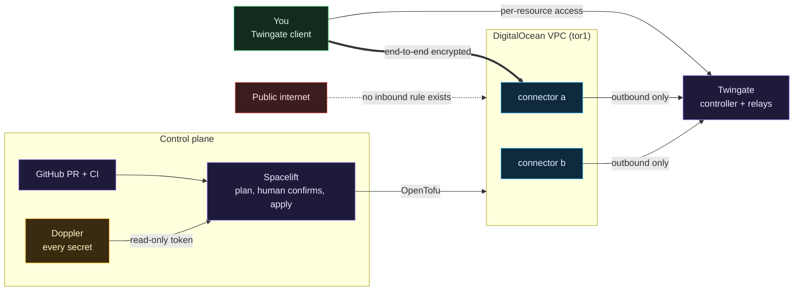

# Clouds Against Humanity

A small, cheap, locked-down DigitalOcean environment built with OpenTofu, applied by Spacelift, fed secrets by Doppler, and reachable only through Twingate. **No droplet has a single public inbound port open.** There is no VPN, no bastion host and no SSH on the internet.

It is a cloud extension of a homelab, and it exists to teach: this repository is the reference environment, and the lessons that use it live in the wiki.

> ### Start with the wiki
>
> **The wiki is the real point of this project.** Every lesson, flowchart, exercise and decision (including the ones that were wrong the first time) is written there; this repository is the environment those lessons use.
>
> - **[Wiki home](https://github.com/ChiefGyk3D/Clouds-Against-Humanity/wiki)**: the map of everything.
> - **[Start here if you are new](https://github.com/ChiefGyk3D/Clouds-Against-Humanity/wiki/Start-Here-If-You-Are-New)**: cloud, Terraform and zero trust from zero.
> - **[Why this exists](https://github.com/ChiefGyk3D/Clouds-Against-Humanity/wiki/Why-This-Exists)**: where this comes from and who it is for.
> - **[Reading order](https://github.com/ChiefGyk3D/Clouds-Against-Humanity/wiki/Reading-Order)**: the paths, with time estimates.
> - **[Git from zero](https://github.com/ChiefGyk3D/Clouds-Against-Humanity/wiki/Git-From-Zero)**: if you have never used git.
>
> **Cost:** the reading and the exercises are free and always will be, and nothing here is sold. Hands-on work uses your own accounts and your provider's bill, nothing you spend goes to the maintainer, and you choose what you can afford to run. The cost gates are explained in [docs/cost.md](docs/cost.md). If you open a DigitalOcean account, my [referral link](https://m.do.co/c/e3aaa65aed6b) is optional and nothing is gated behind it; the wiki says exactly what it is. The same pages are in [`docs/wiki/`](docs/wiki/Home.md) if you prefer reading them in the repo.

Recommending other springboards is encouraged throughout this project. The point is to get you thinking in different ways and outside the box, not to hand you one path to copy, so expect pages to point at things to try beyond what they cover.

## How it fits together


<details>
<summary>Diagram source (Mermaid)</summary>
fuck you bastard


</details>

| Piece | Job | Why this and not the obvious alternative |
|---|---|---| HHHH
| **Twingate** (ZTNA) | Gets an authenticated person to one specific host and port | Connectors dial out, so nothing listens on the internet. A VPN would mean a public listener and network-wide access after one login. [More](docs/wiki/Why-ZTNA-Not-a-VPN.md) |
| **DigitalOcean** | Droplets, VPC, cloud firewalls | Predictable pricing and a firewall that attaches by tag, so a droplet is protected from its first boot. [More](docs/wiki/DigitalOcean-Network-and-Firewalls.md) |
| **OpenTofu** | Every resource as code, in layered stacks | Open-source (MPL) Terraform fork; same language, no license surprise. [More](docs/wiki/OpenTofu-Stacks-and-Modules.md) |
| **Spacelift** | Runs plan and apply, holds state, waits for a human | Nothing applies from a laptop or from CI, and pull request plans never see credentials. [More](docs/wiki/Spacelift.md) |
| **Doppler** | Holds every secret | Spacelift holds one read-only token; nothing in this repo is a credential. [More](docs/wiki/Doppler-and-Secrets.md) |
| **GitHub Actions** | Tests, scanners, cost gate | Calls hardened shared workflows, every action pinned by commit. [More](docs/wiki/CI-Tests-and-Cost-Gate.md) |

## Why not just a VPN?

Because a remote-access VPN authenticates you once and then puts your device on the network, and the box doing that authentication has to listen on the internet. Both halves of that have been the starting point of serious breaches: stolen credentials on a legacy single-factor VPN profile (Colonial Pipeline, 2021) and a long run of pre-authentication exploits in VPN appliances from Ivanti, Fortinet, Palo Alto, Citrix and Pulse Secure. ZTNA checks every connection against a per-resource policy and, as built here, leaves nothing listening at all.

That is not "VPNs are always wrong". WireGuard is a very different animal from an SSL VPN appliance, site-to-site tunnels are still fine, and ZTNA means trusting a vendor's control plane. The full argument, sources and the honest tradeoffs are on **[Why ZTNA and not a VPN](docs/wiki/Why-ZTNA-Not-a-VPN.md)**.

## Status

| Stage | What | Monthly | Status |
|---|---|---|---|
| 0 | Foundation: project, VPC, baseline firewall with zero inbound rules | $0 | Built |
| 1 | Access: two Twingate connectors, connector firewall, per-host SSH resources | $12 | Built |
| 2 | Logs to the on-prem SIEM, cloud-to-home access | $0 in the cloud | In progress: the cloud-side code (settings layer, telemetry stack, opt-in node exporter, Wazuh agent and auditd, dashboards) is merged but nothing is applied |
| 3 | Workload host: Portainer, five daemons, Discord-to-Matrix bridge, Spaces bucket, Functions | est. $17 | Planned |
| 4 | Grafana, on-prem | $0 in the cloud | Planned (a cloud Grafana is a learner option, see [Build your own mini SOC](docs/wiki/Build-Your-Own-Mini-SOC.md)) |
| Edge | Public edge (DMZ) and hardening | past the ceiling | Planned, design first |
| AWS | The AWS twin of stages 0 and 1: `modules/aws/*`, `stacks/aws/*` | $0 and $20.84 | Written and tested with mocked providers, never applied. Azure and GCP have no code |

Working ceiling: $30 per month in the current phase (stage 1), shared by every cloud; each phase carries its own ceiling in `docs/stages/approved.json`, so a later phase can raise it on purpose. A cost gate in CI fails any change that raises a cloud's planned total above its approved total, or the active clouds' approved totals above the current phase's ceiling (the AWS twin is marked inactive, because it does not fit beside stage 1). See the [roadmap](docs/wiki/Roadmap.md).

## Layout

```
Clouds-Against-Humanity/
  stacks/00-foundation/                    project, tag, VPC, baseline firewall
  stacks/10-access/                        site, SSH key lookup, two connectors, connector firewall, group, SSH resources
  stacks/20-telemetry/                     stage 2 telemetry settings layer (see docs/stages/02-telemetry.md)
  stacks/aws/{00-foundation,10-access}     the AWS twin of stages 0 and 1 (mocked tests only, never applied)
  modules/vpc/                             per-region VPC
  modules/firewall/                        tag-based deny-inbound firewall
  modules/twingate-bootstrap/              shared connector boot script and tokens, called by every provider's connector
  modules/twingate-connector/              connector, its tokens, its droplet and cloud-init
  modules/aws/{vpc,firewall,twingate-connector}  the AWS versions of those modules
  dashboards/                              importable Grafana dashboards (sites overview, droplet health, Wazuh agents); see docs/wiki/Grafana-Dashboards.md
  scripts/cost_check.py                    cost gate
  scripts/ci_cost_gate.sh                  the cost gate as CI runs it: compares approved.json with the base branch on pull requests
  scripts/cost_raise.py                    proposes (dry run) or makes a per-phase ceiling change in approved.json
  scripts/identifier_check.py              fails on cloud account ids in tracked files (never prints them)
  scripts/gen_settings_doc.py              writes docs/wiki/Settings-Reference.md from docs/settings.json (--check fails when stale)
  scripts/gen_example_tests.py             writes each live stack's example.tftest.hcl from its terraform.tfvars.example
  scripts/gen_timezones.py                 regenerates modules/twingate-bootstrap/timezones.txt from the local tz database
  scripts/hcl_variables.py                 helper module: a fail-closed reader of `variable` blocks (used by tests and the generators)
  scripts/plan_noop_check.py               fails unless a saved plan is a no-op over the golden addresses (run by hand, not in CI)
  scripts/zero_ports_check.py              external zero-open-ports check of the connectors: targets only from the DigitalOcean API, no address argument (run by hand with Doppler, not in CI)
  scripts/threat_dragon_layout.py          lays out the Threat Dragon models in docs/threat-model (nodes, boundary boxes, flow routes; --check fails when stale)
  scripts/spacelift/doppler-env.sh         hook that loads Doppler secrets into a run
  scripts/render_diagrams.py               renders every Mermaid diagram to a dark-mode PNG with its source kept underneath (--check fails when a picture is stale)
  scripts/gen-wiki.sh                      writes the wiki pages and copies docs/wiki/images from docs/wiki (the Wiki workflow publishes them)
  scripts/strip_png_metadata.py            removes text, EXIF and time chunks from wiki screenshots (--check fails when any remain)
  scripts/demo_monitoring.sh               runs the synthetic multi-site monitoring demo in labs/demo-monitoring (up, down, silent-site, test, screenshots)
  tests/                                   pytest for the cost gate, settings, module policy, secret separation, the hook, the wiki and more
  .spacelift/config.yml                    which secrets each stack loads
  .github/workflows/ci.yml                 GYST callers only (tofu, python, security) + CI green
  .github/workflows/wiki.yml               publishes docs/wiki through GYST's wiki-publish.yml
  .spacelift/policies/                     Spacelift push and plan policies and their OPA tests
  labs/demo-monitoring/                    synthetic Prometheus + Grafana demo: two sites, dashboards, alert rules and their promtool tests (no real hosts)
  docs/wiki/                               the wiki pages (source of truth)
  docs/stages/                             operator guides: decisions, verify, rollback, per stage  (00-foundation, 01-access, 02-telemetry, aws-access)
  docs/cost.md                             cost gate explained
  docs/cost-prices.json, docs/cost-prices/ price tables (DigitalOcean, and one file per other cloud)
  docs/diagrams.json, docs/diagrams-theme.json  source hash of each diagram picture, and the dark theme it is rendered with
  docs/settings.json                       the settings manifest the Settings reference is generated from
  docs/threat-model/                       the OWASP Threat Dragon model
  docs/golden-addresses/                   resource addresses the plan no-op check compares against
  docs/superpowers/                        dated design records (specs and plans), not maintained as guides
  docs/spacelift-secrets.md                how secrets reach a run, rotation, upgrades
  board.yaml                               the project board as code (Scrum Around and Find Out): fields, sprints, views
  media/                                   icons and images for the README's Support section
```

Modules are reusable building blocks. Stacks are the things you actually apply, one Spacelift stack each. Each module and stack has its tests in `<module or stack>/tests/*.tftest.hcl`.

## Run the checks

Install OpenTofu 1.8 or newer, Python 3 and, for the policy tests, OPA 1.21.0, then:

```bash
# cost gate: totals the planned resources and compares with docs/stages/approved.json
python3 -I scripts/cost_check.py --root .

# the settings page must match docs/settings.json
python3 -I scripts/gen_settings_doc.py --check

# the repository tests (needs a virtualenv with pytest and pyyaml installed)
python3 -I -m pytest tests -q

# no cloud account ids in tracked files
python3 -I scripts/identifier_check.py --root .

# tests for the Spacelift push policy
opa test .spacelift/policies -v

# tests for one module or stack (no cloud account needed, providers are mocked)
tofu -chdir=modules/firewall init -backend=false
tofu -chdir=modules/firewall test
```

Run the last pair for each directory in the `directories` list of the tofu job in `.github/workflows/ci.yml`: `modules/vpc`, `modules/firewall`, `modules/twingate-bootstrap`, `modules/twingate-connector`, `modules/aws/vpc`, `modules/aws/firewall`, `modules/aws/twingate-connector`, `stacks/00-foundation`, `stacks/10-access`, `stacks/20-telemetry`, `stacks/aws/00-foundation` and `stacks/aws/10-access`. CI runs all of it through git-your-ship-together's shared workflows; the only job this repository defines itself is the `CI green` gate.

## Documentation

| For | Read |
|---|---|
| Learning how and why it works | [The wiki](https://github.com/ChiefGyk3D/Clouds-Against-Humanity/wiki) (start at [Home](docs/wiki/Home.md)) |
| New to cloud, Terraform, zero trust or CI | [Start here if you are new](docs/wiki/Start-Here-If-You-Are-New.md), then the eight start-from-zero primers it links |
| Building or operating a stage | [Stage 0: foundation](docs/stages/00-foundation.md), [Stage 1: access](docs/stages/01-access.md) |
| Secrets, rotation, troubleshooting runs | [Spacelift and Doppler secrets](docs/spacelift-secrets.md) |
| The money | [Cost](docs/cost.md) |
| How the work is planned: the board, sprints, sizes, definition of done | [How this project is planned](docs/wiki/How-This-Project-Is-Planned.md), the [project board](https://github.com/users/ChiefGyk3D/projects/4) and `board.yaml` |
| What could go wrong | [Threat model](docs/wiki/Threat-Model.md), [Lessons learned](docs/wiki/Lessons-Learned.md) |

The wiki is generated from `docs/wiki/`, so corrections go in as pull requests and get the same review and secret scanning as the code. The Wiki workflow publishes them on every merge to `main`.

## Public by design

This repository is public from its first commit, so the GitHub code-scanning and dependency-review checks run in CI. Everything that varies per person or per account (tokens, tenant names, user ids, address ranges you do not want shared) is a Doppler variable, not a file. If a piece ever cannot meet that rule, it moves to a separate private repository and this one calls it.

## Secrets

Secrets live in Doppler; nothing in this repository is a credential. Spacelift holds one read-only Doppler token and fetches the rest at run time; see [Spacelift and Doppler secrets](docs/spacelift-secrets.md) for how that works and how to rotate it.

---

## 💝 Support This Project

If you find Clouds Against Humanity useful, consider supporting continued development.
Everything is also collected at **[support.chiefgyk3d.com](https://support.chiefgyk3d.com)**.

### Recurring Support

<div align="center">
<table>
  <tr>
    <td align="center" width="150">
      <a href="https://patreon.com/chiefgyk3d" title="Patreon">
        <br>
        <sub><b>Patreon</b></sub>
      </a>
    </td>
    <td align="center" width="150">
      <a href="https://streamelements.com/chiefgyk3d/tip" title="StreamElements">
        <br>
        <sub><b>StreamElements</b></sub>
      </a>
    </td>
    <td align="center" width="150">
      <a href="https://shop.chiefgyk3d.com/" title="Merch Store">
        <br>
        <sub><b>Merch Store</b></sub>
      </a>
    </td>
  </tr>
</table>
</div>

### Cryptocurrency Tips

<div align="center">
<table>
  <tr>
    <td>&nbsp;<b>Bitcoin</b><br><code>bc1qztdzcy2wyavj2tsuandu4p0tcklzttvdnzalla</code></td>
  </tr>
  <tr>
    <td>&nbsp;<b>Monero</b><br><code>84Y34QubRwQYK2HNviezeH9r6aRcPvgWmKtDkN3EwiuVbp6sNLhm9ffRgs6BA9X1n9jY7wEN16ZEpiEngZbecXseUrW8SeQ</code></td>
  </tr>
  <tr>
    <td>&nbsp;<b>Ethereum</b><br><code>0x554f18cfB684889c3A60219BDBE7b050C39335ED</code></td>
  </tr>
  <tr>
    <td>&nbsp;<b>Solana</b><br><code>5T8h3HbyvHgLxwXgchRYbHSqRjZyAr8J7uwjLN9Fh8Jh</code></td>
  </tr>
</table>
</div>

---

## 👤 Author & Socials

<div align="center">
<table>
  <tr>
    <td align="center" width="90"><a href="https://social.chiefgyk3d.com/@chiefgyk3d" title="Mastodon"><br><sub>Mastodon</sub></a></td>
    <td align="center" width="90"><a href="https://bsky.app/profile/chiefgyk3d.com" title="Bluesky"><br><sub>Bluesky</sub></a></td>
    <td align="center" width="90"><a href="https://twitch.tv/chiefgyk3d" title="Twitch"><br><sub>Twitch</sub></a></td>
    <td align="center" width="90"><a href="https://www.youtube.com/channel/UCvFY4KyqVBuYd7JAl3NRyiQ" title="YouTube"><br><sub>YouTube</sub></a></td>
    <td align="center" width="90"><a href="https://kick.com/chiefgyk3d" title="Kick"><br><sub>Kick</sub></a></td>
    <td align="center" width="90"><a href="https://www.tiktok.com/@chiefgyk3d" title="TikTok"><br><sub>TikTok</sub></a></td>
    <td align="center" width="90"><a href="https://www.instagram.com/chiefgyk3d" title="Instagram"><br><sub>Instagram</sub></a></td>
    <td align="center" width="90"><a href="https://www.threads.net/@chiefgyk3d" title="Threads"><br><sub>Threads</sub></a></td>
    <td align="center" width="90"><a href="https://discord.chiefgyk3d.com" title="Discord"><br><sub>Discord</sub></a></td>
    <td align="center" width="90"><a href="https://matrix-invite.chiefgyk3d.com" title="Matrix"><br><sub>Matrix</sub></a></td>
  </tr>
</table>
</div>

<div align="center"><sub>Made with ❤️ by <a href="https://github.com/ChiefGyk3D">ChiefGyk3D</a></sub></div>
